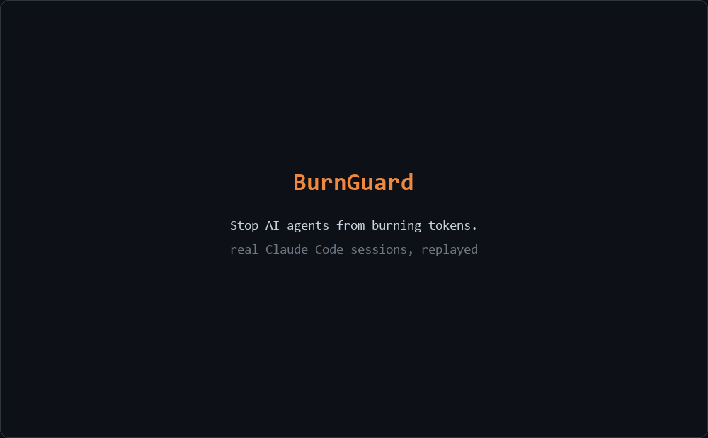

# BurnGuard

**Stop AI agents from burning tokens.**

BurnGuard is a small, local guard for [Claude Code](https://code.claude.com) and for agents you write yourself. It:

- **blocks loops**: when an agent runs the same command and keeps getting the same result, the next attempt is refused with a reason, and the agent is stopped if it keeps trying
- **enforces a daily token budget**: it counts the real usage Claude Code records and stops the agent when the day's budget is spent
- **keeps secrets away from the model**: it blocks prompts containing API keys, redacts keys from command output before the model sees it, and refuses to read `.env` / key files
- **flags prompt injection** in files and web pages the agent reads, so the model treats that text as data

It has no runtime dependencies, makes no network calls, and keeps all state in `~/.burnguard/`.



<sub>The demo replays real Claude Code sessions. The text is the captured output, trimmed. The key is a fake one made for the demo.</sub>

## Install

Requires Python 3.10+.

```bash
pip install git+https://github.com/AnkitSharma-29/BurnGuard.git
burnguard install          # adds hooks to ~/.claude/settings.json
burnguard budget set 2000000
```

Restart Claude Code. That's it. Check what it has done at any time. This is real output from the demo session above:

```text
$ burnguard status
BurnGuard 0.2.1
  Budget today   50,967 / off weighted tokens
  Hooks          user: off   project (my-app): on
  Since install:
    Repeat calls blocked           3
    Budget stops                   0
    Secrets blocked in prompts     0
    Secrets redacted from output   1
    Secret files blocked           0
    Injections flagged             0
```

Use `burnguard install --scope project` to enable it for one repository only (`.claude/settings.json`), or `--scope local` for a git-ignored `.claude/settings.local.json`. `burnguard uninstall` removes only BurnGuard's entries. Your other hooks are left alone, and the previous file is backed up as `settings.json.burnguard.bak`.

To switch it off for one session: `BURNGUARD_DISABLE=1 claude`.

## How each feature works

### Loop blocking

After every tool call BurnGuard stores a fingerprint of the call (tool + input, ignoring the free-text `description`) and of its result. A failed call (for example a test command exiting non-zero) counts too, with its error as the result. Before a call, if that exact call was already made `loop_max_repeats` times (default 3) in the last `loop_window` calls (default 20) **and returned the identical result every time**, the call is denied and Claude is told why.

Claude Code can send several identical calls in one batch, all checked before any of them finishes. BurnGuard counts calls that are still running, so a batch cannot slip past the limit.

Re-running tests after editing code is not a loop, because the output changes. After `loop_hard_stop_after` loop blocks in one session (default 3), the agent is stopped.

### Daily budget

Claude Code writes the API `usage` of every model response to the session transcript. BurnGuard reads new transcript lines (including subagent transcripts) on each prompt and tool call and adds them up as **weighted tokens**:

```
input + cache_creation + output + cache_read × 0.1
```

Cache reads are discounted because they are billed at about a tenth of normal input, and a long session re-reads its whole context every turn. Counting them in full would use up any reasonable budget in minutes. Change the weight with `burnguard config cache_read_weight 1.0`.

When the budget is spent, new prompts are blocked before they reach the model, and an agent in the middle of a task is stopped at its next tool call. The budget is per machine, across all projects, and resets at local midnight.

### Secrets

| Where | What happens |
|---|---|
| Your prompt | Blocked (not sent) if it contains a known secret format. `burnguard config secrets_in_prompt warn` only warns. |
| Bash output | Secrets are replaced with `[REDACTED:<kind>]` before the model sees the output. |
| `Read` of `.env`, `*.pem`, `*.key`, `id_rsa`, `credentials.json`, ... | Refused. `.env.example`, `.pub` etc. are allowed. |

Detected secret formats: private key blocks, AWS access keys, GitHub tokens, Anthropic / OpenAI / OpenRouter / Google / Slack / Stripe keys, JWTs, credentials in URLs, and `password=` / `api_key=` style assignments with an opaque value.

### Prompt-injection flags

When the result of a tool (web fetch, file read, command output, MCP tool) contains phrasing like "ignore previous instructions", "you are now in developer mode" or chat-template tokens, BurnGuard adds a note to the model's context saying the content is untrusted. It normalises case, Unicode and zero-width characters first. It does not block anything.

## Use it in your own agent

```python
from burnguard import Budget, BudgetExceeded, LoopDetector, redact, scan

budget = Budget()                    # shares the limit set by `burnguard budget set`
loops = LoopDetector(max_repeats=3)

for step in range(50):
    budget.check()                   # raises BudgetExceeded when today's budget is spent
    prompt = redact(build_prompt())  # strips secrets and personal data
    text, usage = call_llm(prompt)
    budget.record_usage(usage)       # Anthropic-style usage dict, or budget.record(n)
    if loops.is_loop(prompt, text):  # same call, same result, 3 times
        break
```

`scan(text)` returns findings (`secret:*`, `pii:*`, `injection`). `redact(text)` replaces secrets and personal data (email, Luhn-valid card numbers, US SSNs, public IPv4 addresses, international phone numbers).

From the shell: `burnguard scan file.txt` (exit code 1 if anything is found) or `cat file | burnguard scan --redact`.

## MCP server

For MCP clients such as Cursor or Claude Desktop:

```bash
pip install "burnguard[mcp] @ git+https://github.com/AnkitSharma-29/BurnGuard.git"
```

```json
{ "mcpServers": { "burnguard": { "command": "burnguard", "args": ["mcp"] } } }
```

Tools: `budget_status`, `record_tokens`, `scan_text`, `redact_text`. Works with MCP Python SDK 1.x and 2.x.

## Works alongside other Claude Code tools

`burnguard install` and `burnguard uninstall` only touch BurnGuard's own hook entries, so other tools' hooks stay in place.

**Tested with [Trail-Code](https://github.com/trailhq/Trail-Code) 0.29.0** (Claude Code 2.1, Windows). The two do different jobs: Trail-Code helps an agent find the right code so it uses fewer tokens, and BurnGuard caps and guards what it spends. In one real session with both installed:

- Trail-Code added its code map at session start and with the prompt.
- BurnGuard blocked a repeated command on the 4th try and redacted an AWS key from Bash output.
- Neither tool reported a hook error.
- Re-running either tool's installer kept the other tool's hooks.

## Configuration

`burnguard config` prints every setting. `burnguard config <key> <value>` changes one.

| Setting | Default | |
|---|---|---|
| `daily_token_limit` | off | weighted tokens per day (`burnguard budget set/off`) |
| `cache_read_weight` | `0.1` | how much a cached input token counts |
| `loop_max_repeats` | `3` | identical call+result repeats before blocking |
| `loop_window` | `20` | recent tool calls remembered per session |
| `loop_hard_stop_after` | `3` | loop blocks before the agent is stopped |
| `secrets_in_prompt` | `block` | `block`, `warn` or `off` |
| `redact_tool_output` | `true` | redact secrets in Bash output |
| `block_secret_files` | `true` | refuse `Read` on `.env` / key files |
| `flag_injection` | `true` | warn the model about injection-like content |

## Limits

These are the known limits. They are not hidden in an issue tracker.

- **Pattern matching is not a security boundary.** The secret, personal-data and injection checks catch common formats and obvious phrasing. A determined attacker or an unusual key format gets through. Use BurnGuard as a seatbelt alongside proper secret management and permission settings.
- **Redaction covers Bash output only.** Secrets in other tools' output (for example `Grep` results or a non-`.env` file read with `Read`) still reach the model.
- **The budget can overshoot by one model turn.** It is enforced at prompt and tool-call boundaries, and a response already being generated is not cut off.
- **Budget counting relies on Claude Code's transcript format**, which is not a documented API. It is verified with Claude Code 2.1.x. If the format changes, BurnGuard counts zero rather than breaking your session. If `burnguard status` stops showing usage, that is the cause.
- **Weighted tokens are not dollars.** Model prices differ, and the budget is a volume cap.
- **Each hook call starts Python**, which takes about 0.25 s per tool call on the Windows machine it was tested on.
- If BurnGuard itself fails, it does nothing and lets the agent continue. Errors go to `~/.burnguard/burnguard.log`.

## Develop

```bash
git clone https://github.com/AnkitSharma-29/BurnGuard.git && cd BurnGuard
python -m venv .venv && . .venv/bin/activate      # Windows: .venv\Scripts\activate
pip install -e ".[dev]"
pytest && ruff check src tests
```

The hook tests run the real `burnguard hook` process with Claude Code event payloads, including one captured from a live session.

## License

MIT
